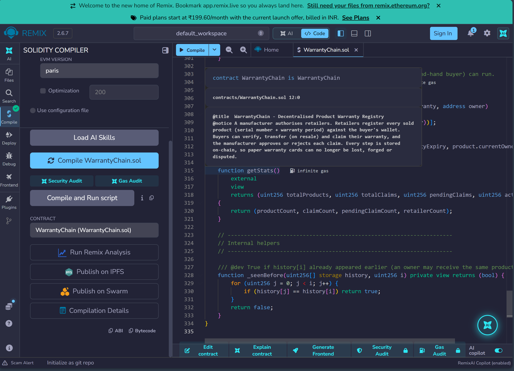
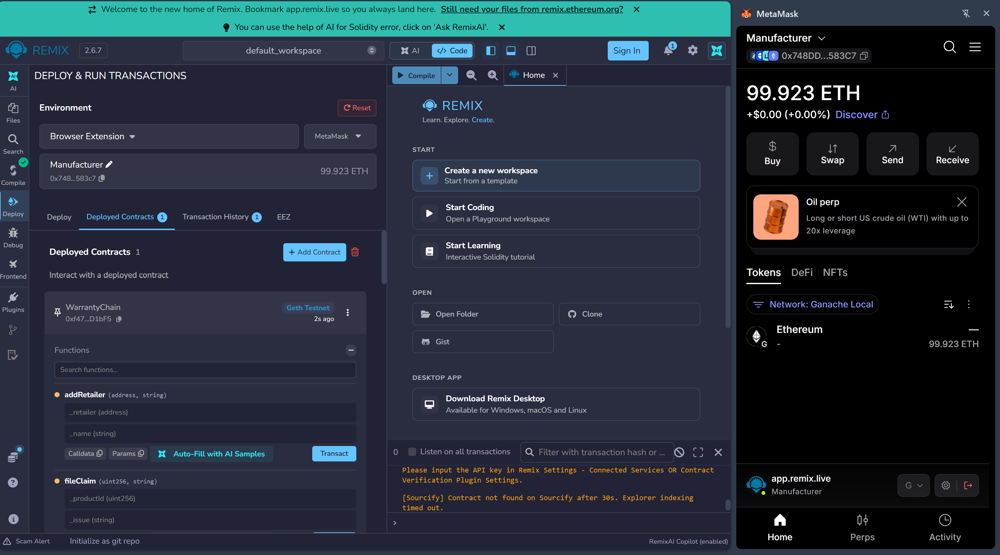
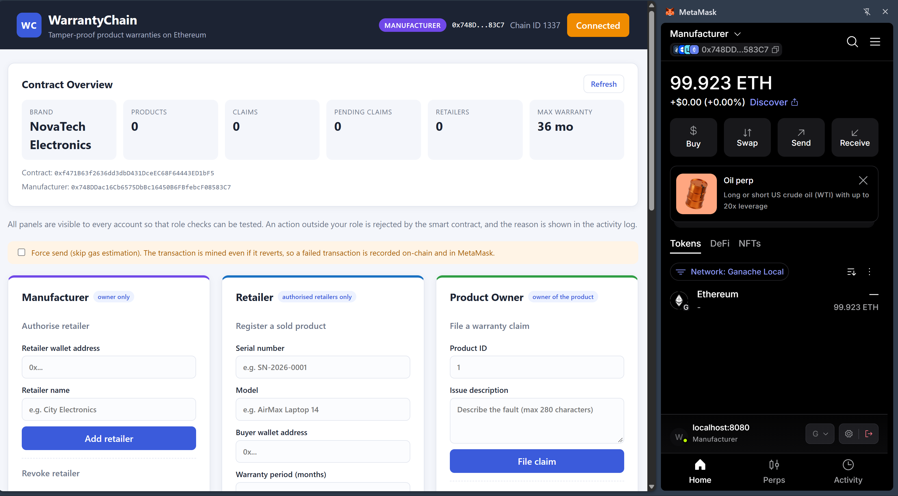
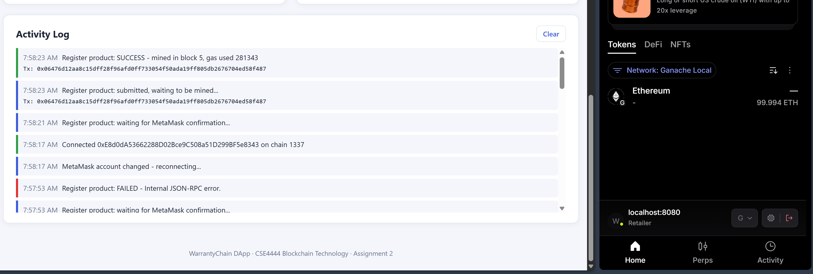
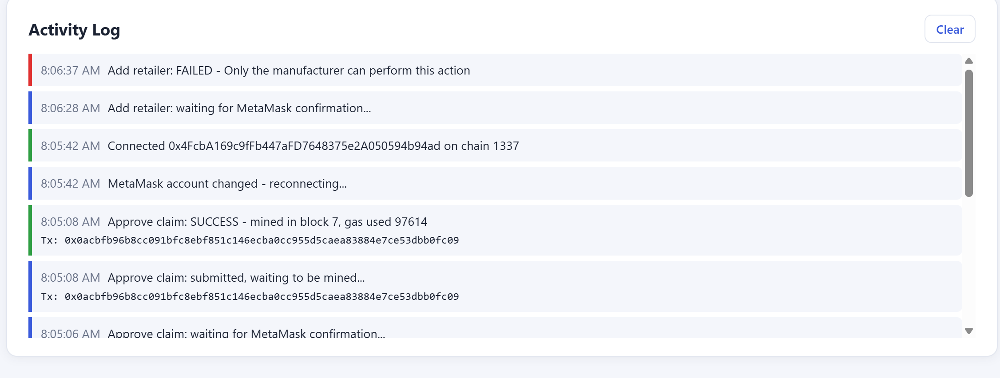
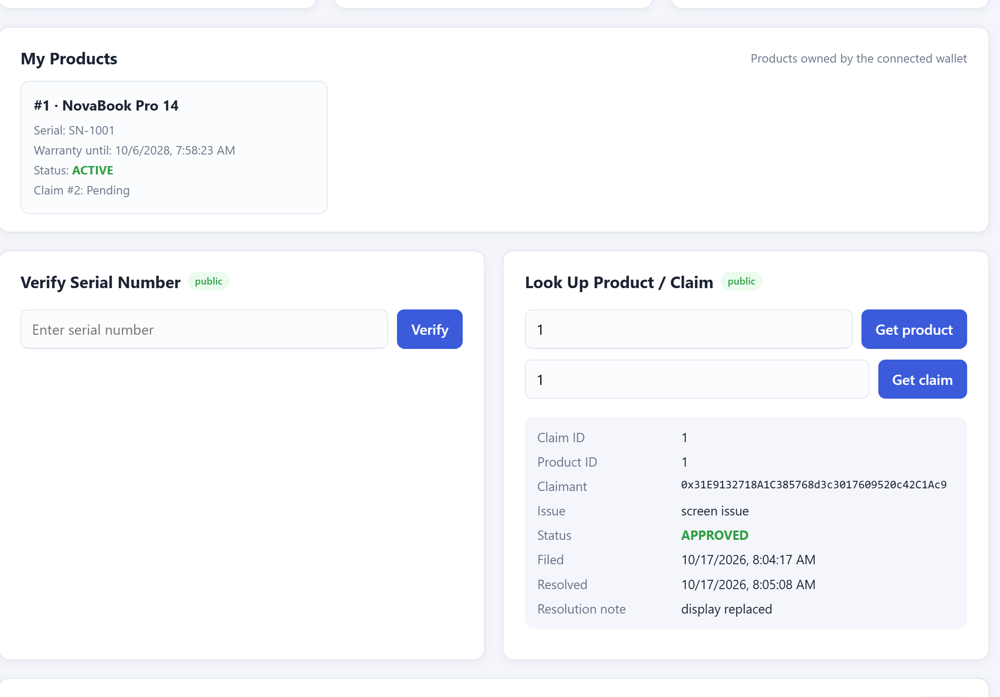
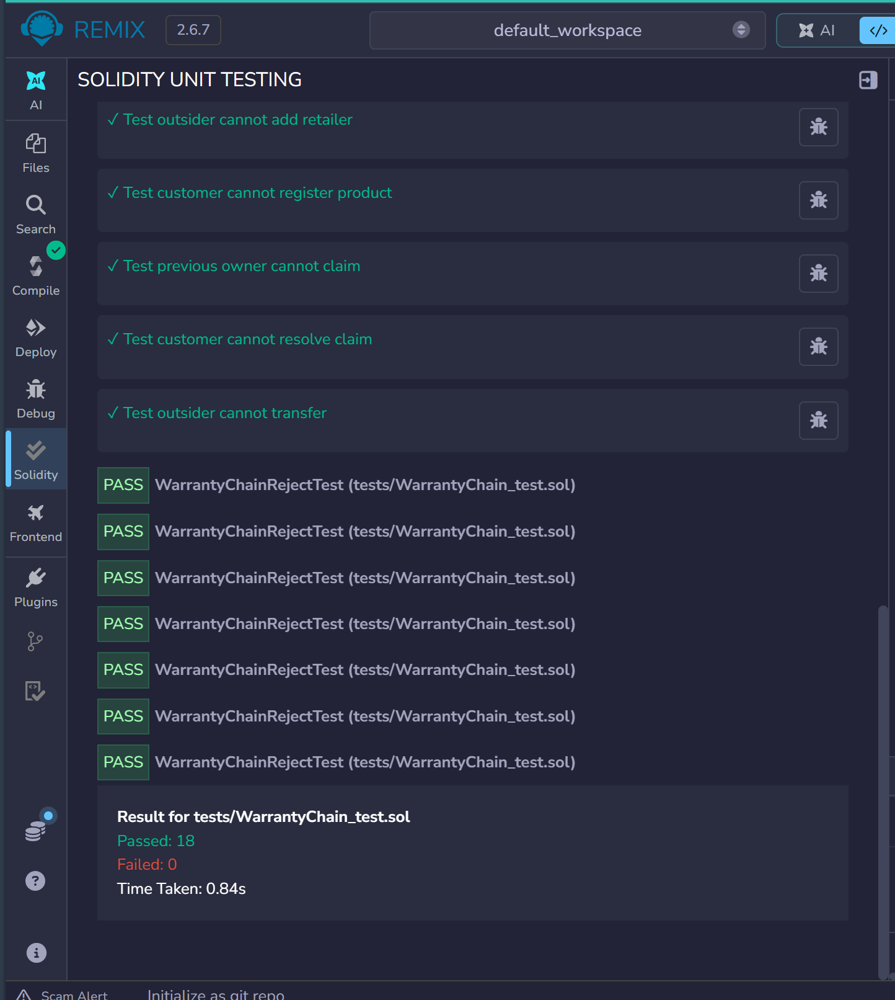
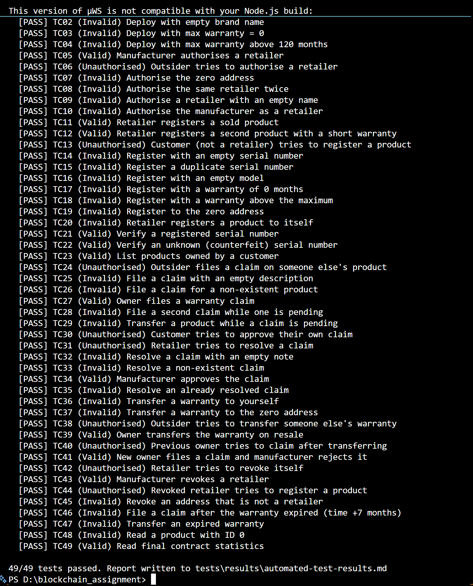
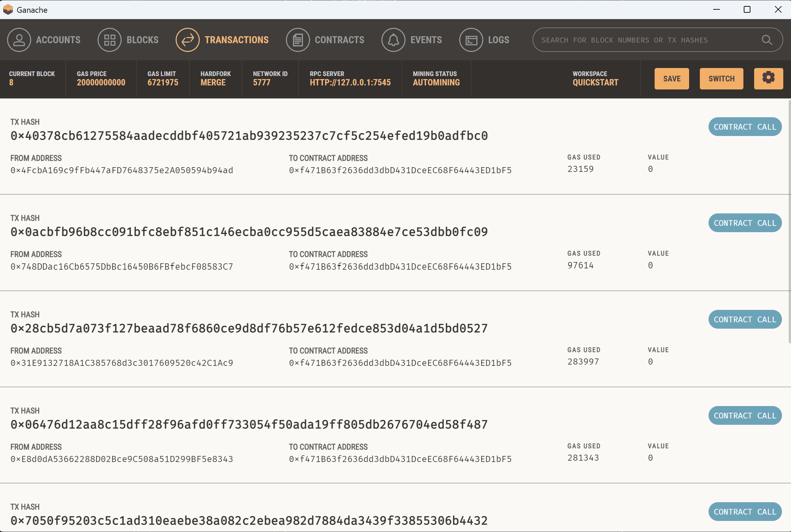
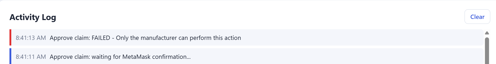

# WarrantyChain - Decentralised Product Warranty Registry

> **Course:** Blockchain Technology (CSE4444) - Assignment 2
> **Student:** Aditya  Aryan Sahu | **Registration No.:** 230905560

WarrantyChain is a decentralised application (DApp) built on Ethereum that
replaces paper warranty cards with tamper-proof, on-chain warranty records. A
manufacturer authorises retailers, retailers register each product they sell
against the buyer's wallet, and buyers can verify, transfer and claim their
warranty. The manufacturer approves or rejects each claim. Every action is a
blockchain transaction, so warranty records can't be forged or lost, and
claims can't quietly disappear.

---

## Table of Contents

1. [Problem Statement](#1-problem-statement)
2. [Solution and Features](#2-solution-and-features)
3. [Technology Stack](#3-technology-stack)
4. [Repository Structure](#4-repository-structure)
5. [Smart Contract Design](#5-smart-contract-design)
6. [Steps to Execute the Application](#6-steps-to-execute-the-application)
7. [Connecting MetaMask and Interacting with the Contract](#7-connecting-metamask-and-interacting-with-the-contract)
8. [Deployment Network and Contract Address](#8-deployment-network-and-contract-address)
9. [Test Cases and Observed Results](#9-test-cases-and-observed-results)
10. [Screenshots](#10-screenshots)
11. [Security Notes](#11-security-notes)

---

## 1. Problem Statement

Product warranties for electronics and appliances are still managed with paper
cards, printed bills or a manufacturer's private database. This causes problems
in practice:

- **Lost proof of purchase:** customers lose the warranty card or bill, and the
  claim is refused even though the product is still under warranty.
- **Forgery and fraud:** fake bills and altered purchase dates are used to claim
  free repairs. Counterfeit products are sold with fake "official" warranties.
- **No transparency for claims:** a customer can't see whether a claim was
  received or why it was rejected, and service centres can quietly ignore claims.
- **Second-hand sales:** when a product is resold, the remaining warranty usually
  can't be transferred or verified by the new buyer.
- **No trust between parties:** the manufacturer, retailer and customer each keep
  separate records that can disagree.

## 2. Solution and Features

WarrantyChain keeps a single shared warranty ledger on the Ethereum blockchain,
with role-based access enforced by the smart contract.

| Role | Who | What they can do |
|------|-----|------------------|
| **Manufacturer** | Contract deployer (owner) | Authorise or revoke retailers, approve or reject warranty claims |
| **Retailer** | Addresses authorised by the manufacturer | Register a sold product (serial number, model, buyer, warranty period) |
| **Product owner** | The buyer's wallet | File a warranty claim, transfer the warranty to a new owner on resale |
| **Anyone** | Any visitor | Verify a serial number (genuine or counterfeit, warranty active or expired) and view product and claim records |

Key features:

- Unique serial numbers: a product can't be registered twice.
- Warranty expiry is calculated on-chain from the purchase block time.
- Only one pending claim per product. Ownership can't change while a claim is open.
- A full claim history per product, with status (Pending, Approved, Rejected), timestamps and resolution notes.
- Warranty transfer on resale. The previous owner loses all rights.
- A public authenticity check (`verifySerial`) for second-hand buyers.
- Events for every state change, which give an auditable activity trail.

## 3. Technology Stack

| Layer | Technology |
|-------|-----------|
| Smart contract | Solidity `^0.8.20` (compiled with 0.8.26, EVM version `paris`) |
| Development and deployment | Remix IDE |
| Blockchain | Ganache (local Ethereum network) / Sepolia testnet |
| Wallet | MetaMask browser extension |
| Frontend | HTML5, CSS3, vanilla JavaScript |
| Web3 library | Ethers.js v6.13.4 |
| Automated testing | Node.js, Ganache, Ethers.js, solc-js |

## 4. Repository Structure

```
warrantychain-dapp/
├── contracts/
│   └── WarrantyChain.sol            # Solidity smart contract
├── frontend/
│   ├── index.html                   # User interface
│   ├── style.css                    # Styling
│   ├── app.js                       # MetaMask + Ethers.js logic
│   ├── config.js                    # Contract address and network settings
│   └── abi.js                       # Contract ABI (generated by npm run compile)
├── build/
│   └── WarrantyChain.json           # Compiled ABI + bytecode
├── scripts/
│   └── compile.js                   # Compiles the contract and regenerates the ABI
├── tests/
│   ├── WarrantyChain_test.sol       # Remix Solidity unit tests (2 test contracts)
│   ├── helpers/
│   │   └── WarrantyChainTestBase.sol # Shared Remix test helpers (Actor, expectRevert)
│   ├── warrantychain.test.js        # Automated test suite (Ganache)
│   ├── TEST_CASES.md                # Manual UI test cases (valid / invalid / unauthorised)
│   └── results/
│       └── automated-test-results.md
├── deployment/
│   └── DEPLOYMENT.md                # Network, contract address, transaction evidence
├── screenshots/                     # Compilation, deployment, MetaMask, tx evidence
├── package.json
└── README.md
```

## 5. Smart Contract Design

File: [`contracts/WarrantyChain.sol`](contracts/WarrantyChain.sol)

### State variables

| Variable | Type | Purpose |
|----------|------|---------|
| `manufacturer` | `address immutable` | Contract owner, set in the constructor |
| `brandName` | `string` | Brand name, set in the constructor |
| `maxWarrantyMonths` | `uint256 immutable` | Upper limit for any warranty period |
| `productCount`, `claimCount`, `retailerCount`, `pendingClaimCount` | `uint256` | Counters and statistics |
| `isRetailer`, `retailerName` | `mapping(address => ...)` | Authorised retailers |
| `products` | `mapping(uint256 => Product)` | Product and warranty records |
| `claims` | `mapping(uint256 => Claim)` | Warranty claims |
| `serialToProductId` | `mapping(bytes32 => uint256)` | Enforces unique serial numbers and supports fast lookup |
| `productClaimIds`, `ownerHistory` | mappings to `uint256[]` | Claim history and ownership index |

Structs: `Product` (id, serialNumber, model, currentOwner, retailer, purchaseDate,
warrantyExpiry, claimCount, hasPendingClaim) and `Claim` (id, productId, claimant,
issue, status, filedAt, resolvedAt, resolutionNote). Enum: `ClaimStatus { Pending, Approved, Rejected }`.

### Constructor

```solidity
constructor(string memory _brandName, uint256 _maxWarrantyMonths)
```
Sets the deployer as `manufacturer`. It checks that the brand name is not empty
and that the maximum warranty is between 1 and 120 months.

### Functions

| Function | Access | Description |
|----------|--------|-------------|
| `addRetailer(address, string)` | Manufacturer | Authorise a retailer |
| `removeRetailer(address)` | Manufacturer | Revoke a retailer |
| `resolveClaim(uint256, bool, string)` | Manufacturer | Approve or reject a pending claim |
| `registerProduct(string, string, address, uint256)` | Retailer | Register a sold product and start its warranty |
| `fileClaim(uint256, string)` | Product owner | File a warranty claim |
| `transferWarranty(uint256, address)` | Product owner | Transfer the warranty to a new owner |
| `getProduct`, `getClaim`, `getProductClaims` | Public view | Read records |
| `getProductsByOwner(address)` | Public view | Products currently owned by an address |
| `verifySerial(string)` | Public view | Authenticity and warranty check |
| `isUnderWarranty(uint256)`, `getStats()` | Public view | Warranty status and contract statistics |

### Validation (all with `require` and a clear error message)

- **Access control modifiers:** `onlyManufacturer`, `onlyRetailer`, `onlyProductOwner`, `productExists`.
- No zero addresses for retailers, buyers or new owners. A retailer can't register a product to itself, and the manufacturer can't be a retailer.
- Strings must not be empty and have length limits (serial and model up to 64 characters, issue and note up to 280).
- Serial numbers are unique. The warranty period must be between 1 month and `maxWarrantyMonths`.
- A claim can only be filed while the warranty is active, with only one pending claim per product.
- A claim can only be resolved once. A warranty can't be transferred while it has expired or a claim is pending.

### Events

`RetailerAdded`, `RetailerRemoved`, `ProductRegistered`, `WarrantyTransferred`, `ClaimFiled`, `ClaimResolved`.

## 6. Steps to Execute the Application

### Prerequisites

- [Google Chrome](https://www.google.com/chrome/) or another Chromium browser, with the [MetaMask](https://metamask.io/download/) extension
- [Ganache](https://archive.trufflesuite.com/ganache/) (GUI), or Ganache CLI through `npx ganache`
- [Remix IDE](https://remix.ethereum.org) (runs in the browser)
- [Node.js](https://nodejs.org) 18 or later. This is only needed for the automated tests and the local web server.

### Step 1 - Start Ganache

1. Open Ganache and click **Quickstart (Ethereum)**.
2. Note the RPC server, `HTTP://127.0.0.1:7545`, and the chain ID, **1337**.
3. Ganache creates 10 test accounts, each with 100 ETH.

   *CLI alternative:* `npx ganache --port 7545 --chain.chainId 1337`

### Step 2 - Compile the contract in Remix

1. Open https://remix.ethereum.org and create `contracts/WarrantyChain.sol`. Paste the contract source into it.
2. Open the **Solidity Compiler** tab:
   - Compiler: **0.8.26**
   - **Advanced Configurations > EVM Version: `paris`**. This is required for Ganache, which does not support the newer `shanghai` and `cancun` opcodes.
   - **Enable optimization**: ticked, 200 runs. This is required for the Remix unit tests: without it the test contract is about 38 KB, over the 24 KB contract-size limit.
3. Click **Compile WarrantyChain.sol**. A green tick confirms that the compile succeeded.

### Step 3 - Deploy the contract

1. Set up MetaMask with the Ganache network first (see [Section 7](#7-connecting-metamask-and-interacting-with-the-contract)) and select the account you imported for Ganache account 0. This account becomes the manufacturer.
2. In Remix, open **Deploy & Run Transactions** and set **Environment** to **Browser Extension > MetaMask** (called **Injected Provider - MetaMask** in older Remix versions).
   (Alternatively, choose **Dev - Ganache Provider** and enter `http://127.0.0.1:7545`.)
3. Select the contract `WarrantyChain`, expand **Deploy** and enter:
   - `_brandName`: `NovaTech Electronics`
   - `_maxWarrantyMonths`: `36`
4. Click **transact** and confirm in MetaMask.
5. Copy the deployed contract address from **Deployed Contracts** and record it in
   [`deployment/DEPLOYMENT.md`](deployment/DEPLOYMENT.md).

### Step 4 - Configure the frontend

Open [`frontend/config.js`](frontend/config.js) and paste the address:

```js
window.DAPP_CONFIG = {
  CONTRACT_ADDRESS: "0xf471B63f2636dd3dbD431DceEC68F64443ED1bF5", // replace if you redeploy
  EXPECTED_CHAIN_ID: 1337,          // 11155111 for Sepolia
  NETWORK_NAME: "Ganache (localhost:7545)",
};
```

The ABI is already in `frontend/abi.js`. If you change the contract, run
`npm install` and then `npm run compile` to regenerate it.

### Step 5 - Run the frontend

MetaMask does not inject into pages opened as `file://`, so serve the folder over HTTP. Any of these work:

```bash
# Option A - Python
cd frontend
python -m http.server 8080

# Option B - Node.js
npx http-server frontend -p 8080 -c-1

# Option C - VS Code: right-click frontend/index.html and choose "Open with Live Server"
```

Open **http://localhost:8080** in the browser that has MetaMask installed.

### Step 6 (optional) - Run the automated tests

```bash
npm install
npm test
```

## 7. Connecting MetaMask and Interacting with the Contract

### Add the Ganache network to MetaMask

1. In MetaMask, open the network selector and choose **Add network > Add a network manually**.
2. Enter these values:

   | Field | Value |
   |-------|-------|
   | Network name | Ganache Local |
   | New RPC URL | `http://127.0.0.1:7545` |
   | Chain ID | `1337` |
   | Currency symbol | `ETH` |

3. Save the network and switch to it.

### Import the Ganache test accounts

1. In Ganache, click the **key icon** next to an account to show its private key.
2. In MetaMask, open the account menu, choose **Add account or hardware wallet > Import account**, and paste the key.
3. Import 4 or 5 accounts to play the roles: account 0 is the Manufacturer, account 1 the Retailer, accounts 2 and 3 are Customers, and account 4 is an Outsider.

> These are local test keys only. Never paste them into the repository or any file.

### Connect the DApp

1. Open the DApp and click **Connect MetaMask**.
2. Approve the connection in the MetaMask pop-up.
3. The header shows the connected address, chain ID and a **role badge** (Manufacturer, Retailer or Customer).
4. **Contract Overview** loads the live data from the blockchain: brand, product count, claims, pending claims, retailers and maximum warranty.
5. When you switch accounts in MetaMask, the DApp reconnects and updates the role automatically.

### Typical interaction flow

| Step | MetaMask account | DApp panel | Action |
|------|------------------|------------|--------|
| 1 | Manufacturer | Manufacturer > Authorise retailer | Add the retailer's address with the name `City Electronics` |
| 2 | Retailer | Retailer > Register a sold product | `SN-1001`, `NovaBook Pro 14`, the customer's address, `24` months |
| 3 | Anyone | Verify Serial Number | `SN-1001` returns GENUINE, warranty ACTIVE |
| 4 | Customer A | Product Owner > File a warranty claim | Product `1`, describe the fault |
| 5 | Manufacturer | Manufacturer > Resolve warranty claim | Claim `1`, Approve, add a note |
| 6 | Customer A | Product Owner > Transfer warranty | Product `1` to Customer B |
| 7 | Any | Look Up Product / Claim, My Products | View the stored blockchain data |

Every transaction opens a MetaMask confirmation. The **Activity Log** shows the
transaction hash, block number and gas used, or the contract's revert reason if
the transaction fails.

**Force send option:** MetaMask normally estimates gas before sending, so a
transaction that would revert is caught before it is broadcast. Tick **Force
send** to skip that estimate. The transaction is then mined and recorded as
**failed** in MetaMask and Ganache, which is useful as evidence of a failed
transaction.

## 8. Deployment Network and Contract Address

| Item | Value |
|------|-------|
| Network | Ganache (local Ethereum network), `http://127.0.0.1:7545` |
| Chain ID / Network ID | `1337` / `5777` |
| **Contract address** | **`0xf471B63f2636dd3dbD431DceEC68F64443ED1bF5`** |
| Deployment tx hash | `0x563f87d1da10e1f0f6e4cce102569ce23990201e420018e29d31b9fe0f7e7f00` (block 1) |
| Deployer (manufacturer) | `0x748DDac16Cb6575DbBc16450B6FBfebcF08583C7` |
| Constructor arguments | `"NovaTech Electronics"`, `36` |
| Compiler / EVM | solc 0.8.26 / paris, deployed from Remix through MetaMask |

### Transactions executed through the DApp

| Block | Action | From | Status |
|-------|--------|------|--------|
| 2 | `addRetailer(Retailer, "City Electronics")` | Manufacturer | Success |
| 5 | `registerProduct("SN-1001", "NovaBook Pro 14", CustomerA, 24)` | Retailer | Success |
| 6 | `fileClaim(1, "screen issue")` | Customer A | Success |
| 7 | `resolveClaim(1, true, "display replaced")` | Manufacturer | Success |
| 8 | `addRetailer(...)` with Force send | Outsider | **Failed:** Only the manufacturer can perform this action |
| 10 | `resolveClaim(1, ...)` | Customer A | **Failed:** Only the manufacturer can perform this action |

Full deployment details and the transaction log are in [`deployment/DEPLOYMENT.md`](deployment/DEPLOYMENT.md).

## 9. Test Cases and Observed Results

The contract was tested at three levels. Full details are in [`tests/TEST_CASES.md`](tests/TEST_CASES.md).

1. **Automated suite** ([`tests/warrantychain.test.js`](tests/warrantychain.test.js)): **49 / 49 passed**
   (13 valid, 27 invalid, 9 unauthorised). Full report:
   [`tests/results/automated-test-results.md`](tests/results/automated-test-results.md)
2. **Remix Solidity unit tests** ([`tests/WarrantyChain_test.sol`](tests/WarrantyChain_test.sol) + [`tests/helpers/WarrantyChainTestBase.sol`](tests/helpers/WarrantyChainTestBase.sol)): 17 tests in 2 test contracts. Remix result: **Passed 18, Failed 0** (see screenshot 07). Enable the optimizer before running them.
3. **Manual UI tests** through MetaMask and Ganache: [`tests/TEST_CASES.md`](tests/TEST_CASES.md)

### Valid inputs

| ID | Test case | Input | Expected result | Observed result |
|----|-----------|-------|-----------------|-----------------|
| TC01 | Deploy contract | `constructor("NovaTech Electronics", 36)` | Deployed; deployer is the manufacturer | Deployed; manufacturer, brand and maximum warranty stored |
| TC05 | Authorise retailer | `addRetailer(Retailer, "City Electronics")` | Retailer authorised | `isRetailer = true`, `retailerCount = 1` |
| TC11 | Register product | `registerProduct("SN-1001", "NovaBook Pro 14", CustomerA, 24)` | Product #1, owner Customer A | Product #1 owned by Customer A, warranty 720 days |
| TC21 | Verify serial | `verifySerial("SN-1001")` | Registered, under warranty | `registered = true`, `productId = 1`, `underWarranty = true` |
| TC27 | File claim | `fileClaim(1, "Screen flickers after 2 weeks")` | Claim #1 is Pending | Claim #1 Pending, `pendingClaimCount = 1` |
| TC34 | Approve claim | `resolveClaim(1, true, "Display panel replaced")` | Claim #1 is Approved | Claim #1 Approved, note stored |
| TC39 | Transfer warranty | `transferWarranty(1, CustomerB)` | Customer B becomes the owner | Owner of #1 is Customer B; owner lists updated |
| TC41 | Reject claim | `resolveClaim(2, false, "Physical damage not covered")` | Claim #2 is Rejected | Claim #2 Rejected; product `claimCount = 2` |

### Invalid inputs

| ID | Test case | Input | Expected result | Observed result |
|----|-----------|-------|-----------------|-----------------|
| TC02 | Empty brand name | `constructor("", 36)` | Revert | Reverted: "Brand name cannot be empty" |
| TC07 | Zero-address retailer | `addRetailer(0x0, "Ghost")` | Revert | Reverted: "Invalid retailer address" |
| TC14 | Empty serial number | `registerProduct("", ...)` | Revert | Reverted: "Serial number must be 1-64 characters" |
| TC15 | Duplicate serial | `registerProduct("SN-1001", ...)` | Revert | Reverted: "Serial number already registered" |
| TC18 | Warranty above maximum | `registerProduct(..., 37)` | Revert | Reverted: "Warranty period out of allowed range" |
| TC26 | Non-existent product | `fileClaim(99, "Broken")` | Revert | Reverted: "Product does not exist" |
| TC28 | Second pending claim | `fileClaim(1, "Still broken")` | Revert | Reverted: "A claim is already pending for this product" |
| TC35 | Claim resolved twice | `resolveClaim(1, false, ...)` | Revert | Reverted: "Claim already resolved" |
| TC36 | Transfer to self | `transferWarranty(1, CustomerA)` | Revert | Reverted: "Cannot transfer to yourself" |
| TC46 | Claim after expiry (+7 months) | `fileClaim(2, "Left earbud dead")` | Revert | Reverted: "Warranty has expired" |

### Unauthorised inputs

| ID | Test case | Caller | Expected result | Observed result |
|----|-----------|--------|-----------------|-----------------|
| TC06 | Add a retailer | Outsider | Revert | Reverted: "Only the manufacturer can perform this action" |
| TC13 | Register a product | Customer (not a retailer) | Revert | Reverted: "Only an authorised retailer can perform this action" |
| TC24 | File a claim on someone else's product | Outsider | Revert | Reverted: "Only the product owner can perform this action" |
| TC30 | Approve own claim | Customer | Revert | Reverted: "Only the manufacturer can perform this action" |
| TC31 | Resolve a claim | Retailer | Revert | Reverted: "Only the manufacturer can perform this action" |
| TC38 | Transfer someone else's warranty | Outsider | Revert | Reverted: "Only the product owner can perform this action" |
| TC40 | Claim after transferring the product | Previous owner | Revert | Reverted: "Only the product owner can perform this action" |
| TC42 | Revoke itself | Retailer | Revert | Reverted: "Only the manufacturer can perform this action" |
| TC44 | Register after being revoked | Revoked retailer | Revert | Reverted: "Only an authorised retailer can perform this action" |

## 10. Screenshots

Screenshots are stored in [`screenshots/`](screenshots). See [`screenshots/README.md`](screenshots/README.md) for what each one shows.

### Smart contract compilation


### Smart contract deployment


### MetaMask wallet connection


### Successful transaction


### Failed transaction


### Blockchain data displayed through the user interface


### Additional evidence

#### Remix Solidity unit tests


#### Automated test suite (49/49 passed)


#### Ganache transactions


#### Unauthorised attempt: a customer tries to resolve a claim


## 11. Security Notes

- No private keys, seed phrases or passwords are stored in this repository. `.gitignore` excludes `.env` and key files.
- Only Ganache test accounts or testnet accounts with no real value were used.
- Access control is enforced by the contract, not by the UI. Every panel is visible to every account so that unauthorised attempts can be tested, and the contract rejects them.
- The frontend escapes user-supplied text before displaying it, to prevent HTML injection.
